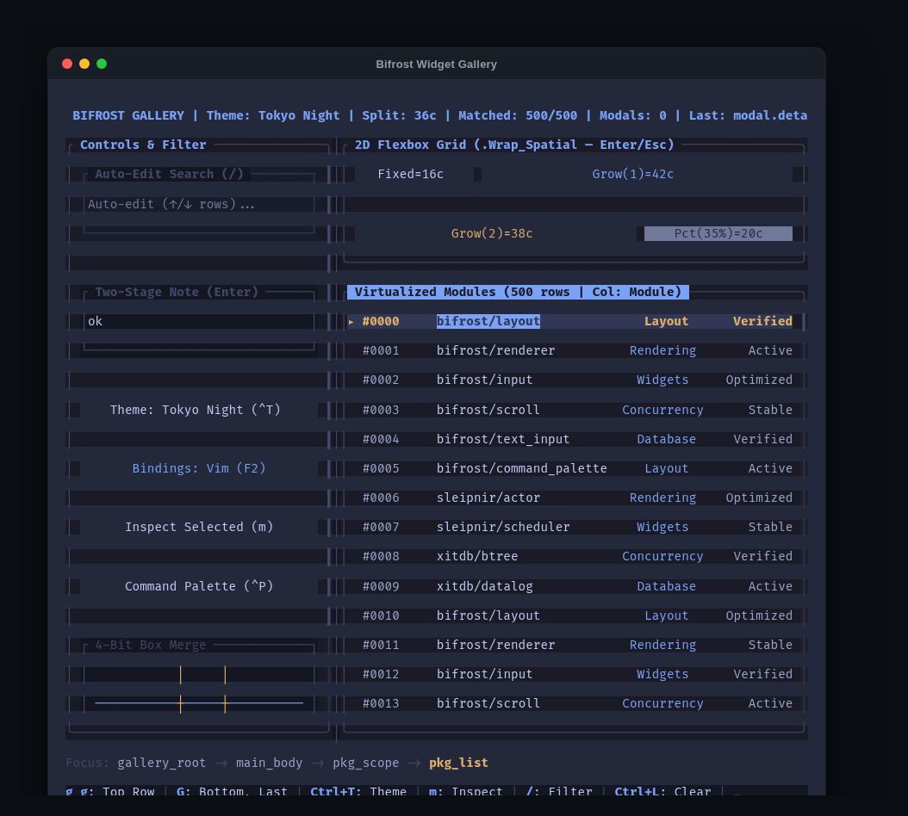
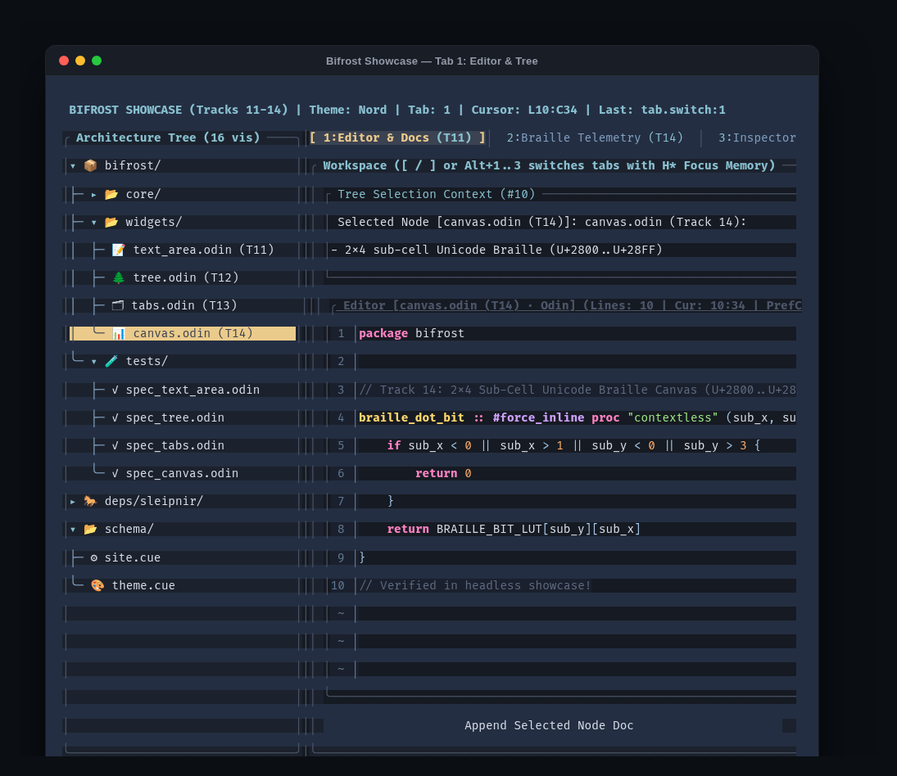
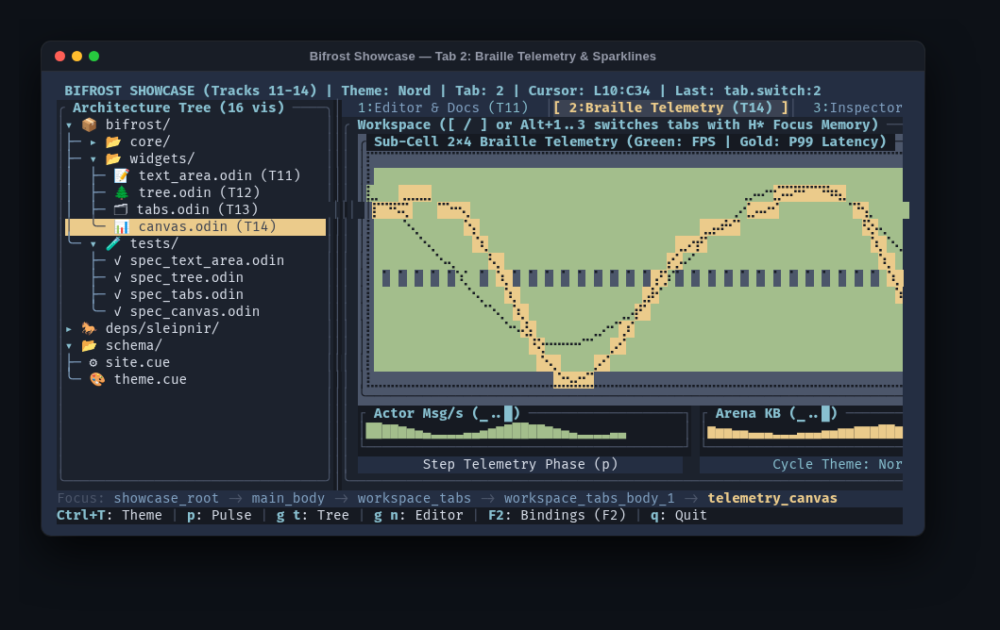
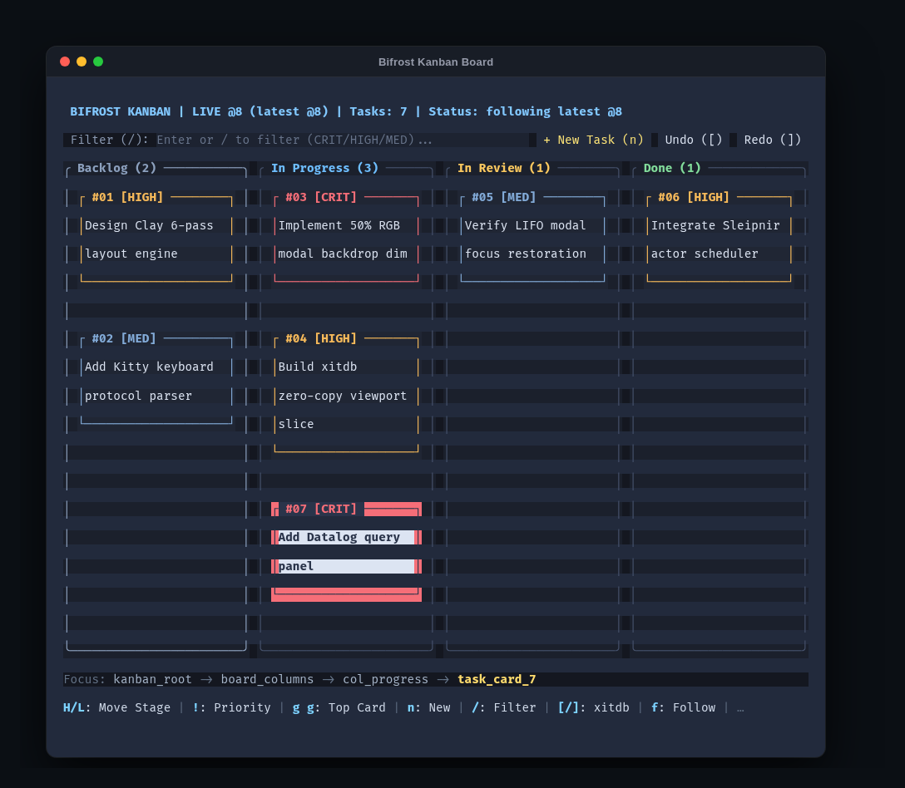
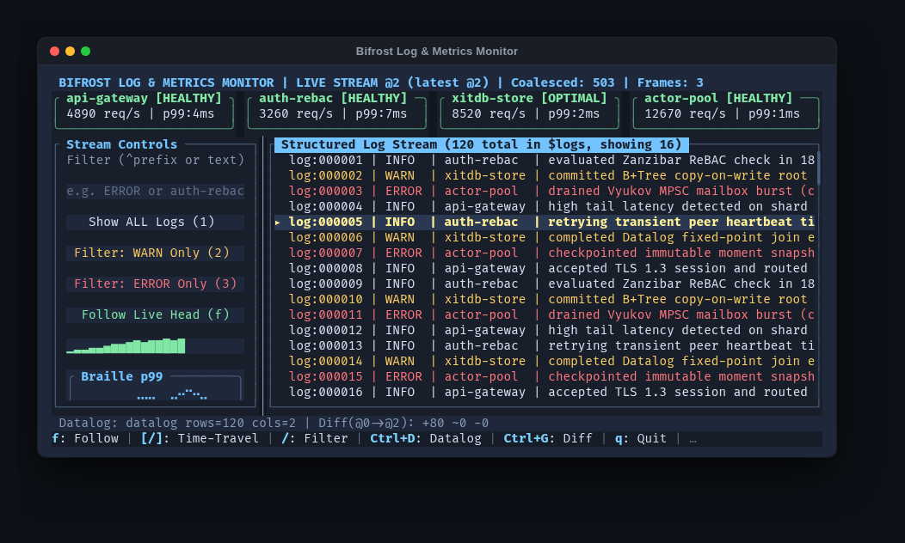
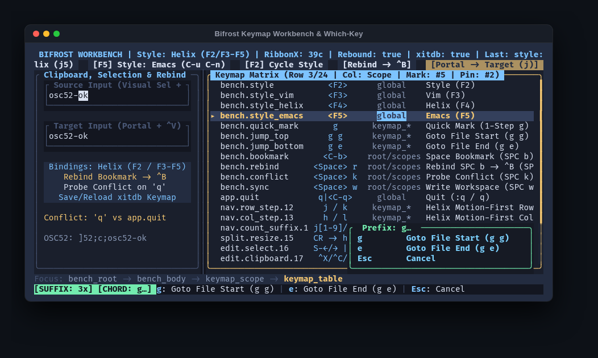

# Bifrost (`package bifrost`)

An immediate-mode, actor-driven Terminal User Interface (TUI) framework for [Odin](https://odin-lang.org/), engineered to bridge [**Sleipnir (`package actor`)**](deps/sleipnir) lock-free actors and [**xitdb (`package xitdb`)**](deps/xitdb) immutable persistent databases.

Bifrost combines a Clay-inspired multi-pass topological Flexbox layout engine, Harel statechart focus scopes with Shallow (H) and Deep (H*) history, 2D spatial cone navigation, multi-style modal keymaps (**Vim**, **Helix**, **Emacs**), and zero-allocation widget state slots into a single cohesive package.

---

## Key Features & Architecture

* **Single-Writer Actor Concurrency (`ui_coordinator.odin`, `ui_actions_effects.odin`, `terminal.odin`):**
  * Dedicated terminal input, timer, and background worker actors communicate with a single-owner `UI_Coordinator_State` actor over lock-free Vyukov MPSC and sharded SPSC mailboxes.
  * Burst coalescing drains up to `DEFAULT_MAX_COALESCE_BATCH` (2048) queued messages before executing a single layout + render pass.
  * Declarative action sinks (`bind_actor_action`, `on_ui_action`, `bind_button_action`) and pure terminal side-effects (`UI_Side_Effect`: OSC 52 clipboard, OSC 2 window title, DECSCUSR cursor shape, focus requests, and Bubble-Tea-style quit filters).
* **Zero-Copy Persistent State & Workspace Snapshots (`xitdb_bridge.odin`, `workspace_persistence.odin`):**
  * Background `Xitdb_Worker_State` actors commit transactions to `xitdb` and send lightweight O(1) `UI_Msg_Commit_Notification` messages containing the new `moment_idx`.
  * The UI actor slices virtualized viewports (`Array_List`, `Linked_Array_List`, `Sorted_Map`, `Counted_Hash_Map`) in O(log₁₆ N) time directly onto `context.temp_allocator`.
  * Built-in `save_ui_workspace_to_xitdb` / `load_ui_workspace_from_xitdb` persists splitter sizes, H/H* scope memory, active keymap style, and custom keybinding overrides directly inside `xitdb`.
* **Clay-Inspired Multi-Pass Topological Layout (`layout.odin`):**
  * Supports `Fit` (`min`, `max`), `Grow` (water-filling and weighted flex with `min`/`max` freeze clamping and exact integer remainder distribution), `Fixed`, `Percent`, word/newline text wrapping, and out-of-flow 9-point anchored `z_layer` overlays in linear array passes with zero recursion.
* **Double-Buffered Cell Renderer & 50% RGB Backdrop Dimming (`renderer.odin`):**
  * Automatic wide-glyph (CJK / Emoji 2-column cell) split healing at clip and overwrite boundaries.
  * 4-bit direction mask box-drawing junction merging (`surface_merge_box_cell`: `─` + `│` → `┼`, `┬`, `┴`, `├`, `┤`).
  * In-place 50% RGB bit-shift and 3-band ANSI-256 backdrop dimming (`.Dim_Screen`, `.Dim_Rect`) and minimal run-length ANSI diffing wrapped in DEC Mode 2026 Synchronized Output (`\x1b[?2026h ... \x1b[?2026l`).
* **Embedded Harel Statechart Focus & 2D Spatial Navigation (`focus_scope.odin`, `spatial_nav.odin`, `input.odin`):**
  * Hierarchical `ui_scope` containers with automatic Shallow (H) and Deep (H*) focus history, `.Trap_Focus` modal shields with LIFO focus restoration, and non-modal floating window MRU z-promotion.
  * Integer-only 2D directional cone scoring (`Left`/`Right`/`Up`/`Down`) with sticky orthogonal lane memory (`preferred_nav_pos`), `.Loop_Spatial` ring wrapping, `.Wrap_Spatial` reading-order grid wrapping, explicit `nav_overrides` portals, and same-frame (0-lag) `scroll_node_into_view`.
* **Declarative Key-Chord Engine, Multi-Style Modal Editing & AST Codegen (`keymap.odin`, `tools/bifrost_gen`):**
  * 1- and 2-step key chords (`g g`, `<C-x> <C-f>`, `q|<C-q>`) with prefix timeout fallback, scope wildcards (`scope=col_*`), transient sub-modes (`Splitter_Submode.Resize`), and action guards (`.Enabled`, `.Disabled_Swallow`, `.Disabled_Bubble`).
  * Live runtime switching (`set_keymap_style`, `cycle_keymap_style`) between **Vim** (prefix counts `5j`), **Helix** (postfix counts `j5`), and **Emacs** (`C-n`/`C-p`/`C-f`/`C-b`, `C-u` universal argument 4ⁿ, `<M-x>` palette).

---

## Widget Catalog (`docs/widget/`)

Every widget is zero-allocation in steady state (backed by fixed-capacity LRU slots on `Input_State` and per-frame arenas on `context.temp_allocator`). Click any widget below for its full API reference, keyboard/mouse table, and examples:

| Widget / Component | Source File | Description | Documentation |
| :--- | :--- | :--- | :--- |
| **`container`, `leaf`, `ui_scope`, `ui_label`, `ui_button`, `ui_modal`** | `layout.odin`, `focus_scope.odin`, `renderer.odin`, `input.odin` | Core layout containers, Harel focus scopes (H/H*), labels, interactive buttons, and z-layered modals with 50% RGB backdrop dimming. | [`docs/widget/primitives_and_scopes.md`](docs/widget/primitives_and_scopes.md) |
| **`ui_text_input`** | `text_input.odin` | Single-line UTF-8 grapheme-aware input with `.Auto_Edit`, `two_stage`, `.Scope_Text_Sink`, `linked_list_id` forwarding, OSC 52 copy/cut, and `Xitdb_Filter`. | [`docs/widget/text_input.md`](docs/widget/text_input.md) |
| **`ui_text_area`** | `text_area.odin` | Multi-line UTF-8 editor with sticky `preferred_col`, dynamic line-number gutter, 2D selection, OSC 52 clipboard, and built-in **Odin** / **CUE** syntax highlighting. | [`docs/widget/text_area.md`](docs/widget/text_area.md) |
| **`ui_virtual_list` & 2D Table Solver** | `scroll.odin`, `xitdb_bridge.odin` | O(1) virtualized viewport for 100,000+ rows, 2D `(row, col)` navigation, monotonic high-water-mark column solver (`resolve_table_columns`), and 64-bit proportional scrollbar. | [`docs/widget/virtual_list_and_table.md`](docs/widget/virtual_list_and_table.md) |
| **`ui_tree`** | `tree.odin` | Virtualized collapsible tree over 10,000+ nodes with box-drawing guides (`├─`, `╰─`, `│`, `▾`, `▸`), `h`/`l` expand/collapse & parent jump, and `id_hash`-persistent state. | [`docs/widget/tree.md`](docs/widget/tree.md) |
| **`ui_tabs` & `ui_tab_bar`** | `tabs.odin` | Focus-scope-integrated tab bar and container with per-tab `<id>_body_<i>` Deep History (H*) restoration, `[` / `]`, `Alt+1..9`, and mouse switching. | [`docs/widget/tabs.md`](docs/widget/tabs.md) |
| **`ui_splitter`** | `splitter.odin` | Interactive 1-cell horizontal/vertical pane divider supporting mouse drag, middle-click reset, keyboard `[RESIZE]` sub-mode, and same-frame rect reflow. | [`docs/widget/splitter.md`](docs/widget/splitter.md) |
| **`ui_command_palette`** | `command_palette.odin` | Floating `Ctrl+P` / `M-x` fuzzy command launcher (`z_layer = 30`) with multi-token subsequence scoring and automatic shortcut badge discovery. | [`docs/widget/command_palette.md`](docs/widget/command_palette.md) |
| **`ui_focus_breadcrumb_bar`, `ui_key_hint_bar`, `ui_which_key_overlay`** | `status_bars.odin` | Zero-lag contextual status bars displaying the live focus path, mode badges (`[EDIT]`, `[RESIZE]`, `[COUNT]`, `[CHORD]`), active key hints, and floating Which-Key popup. | [`docs/widget/status_bars_and_which_key.md`](docs/widget/status_bars_and_which_key.md) |
| **`ui_canvas` & `ui_sparkline`** | `canvas.odin` | ISO/TR 11548-1 2×4 sub-cell Unicode Braille canvas (`U+2800..U+28FF`) with integer Bresenham lines/rects/polylines, plus 8-level vertical block sparklines (`▁▂▃▄▅▆▇█`). | [`docs/widget/canvas_and_sparkline.md`](docs/widget/canvas_and_sparkline.md) |

---

## Quick Start: Immediate-Mode Frame Lifecycle

Bifrost can be driven either via the actor-based `UI_Coordinator_State` (`spawn_ui_coordinator`) or directly in a synchronous immediate-mode loop:

```odin
package main

import "core:os"
import "core:strings"
import "bifrost"

main :: proc() {
	scr: bifrost.Screen
	ctx: bifrost.Layout_Context
	inp: bifrost.Input_State
	store: bifrost.Widget_State_Store

	_ = bifrost.screen_init(&scr, 80, 24)
	defer bifrost.screen_destroy(&scr)
	_ = bifrost.state_store_init(&store)
	defer bifrost.state_store_destroy(&store)

	ansi_out := strings.builder_make()
	defer strings.builder_destroy(&ansi_out)

	// 1. Begin Frame & Layout Pass
	bifrost.state_store_begin_frame(&store)
	bifrost.begin_frame(&scr, bifrost.rgb(22, 26, 34))
	bifrost.begin_layout(&ctx, scr.width, scr.height)

	if bifrost.ui_scope(&ctx, &scr, "root", {
		dir     = .Column,
		width   = bifrost.fixed(scr.width),
		height  = bifrost.fixed(scr.height),
		padding = bifrost.pad_all(1),
		gap     = 1,
		border  = .Rounded,
		title   = "Bifrost Quick Start",
	}) {
		bifrost.ui_text_input(&ctx, &scr, &inp, "search", {
			placeholder = "Type to search...",
			border      = .Plain,
		})
		bifrost.ui_button(&ctx, &scr, "submit_btn", {
			label       = "Run Query",
			focus_flags = {.Default_Focus},
		})
		bifrost.ui_key_hint_bar(&ctx, &scr, &inp, "hints")
	}

	bifrost.end_layout(&ctx)

	// 2. Resolve Input, Sync State & Rasterize to Cell Buffer
	bifrost.resolve_input(&inp, &ctx)
	bifrost.state_store_sync_from_layout(&store, &ctx, &inp)
	bifrost.apply_input_highlights(&scr, &ctx, &inp)
	bifrost.render_layout(&scr, &ctx)

	// 3. Emit Minimal Synchronized ANSI Diff + OSC 52 Clipboard
	_ = bifrost.screen_diff_ansi(&scr, &ansi_out)
	_ = bifrost.flush_osc52_clipboard(&inp, &ansi_out)
	_, _ = os.write_string(os.stdout, strings.to_string(ansi_out))
}
```

---

## Running Tests & Codegen

```bash
# Unit & verification suites (layout, renderer, focus scopes, 2D spatial nav, keymaps, widgets, actors)
odin test bifrost -vet -strict-style -vet-packages:bifrost

# AST keymap & ATDD code generator tests
odin test bifrost/codegen -vet -strict-style

# 4-layer ATDD executable specifications (@(scenario) + in-memory VT verification)
odin test tests -custom-attribute:scenario -vet -strict-style -vet-packages:bifrost,bifrost_tests

# Standalone AST keymap & ATDD code generator CLI
odin run tools/bifrost_gen -- <target_dir>
```

---

## Example Applications (`examples/`)

Every example runs a deterministic, zero-leak headless verification walkthrough by default (printing the rendered Unicode frame buffer) and supports `--live-tty` for interactive raw-terminal execution:

### 1. Widget & Layout Gallery (`examples/widget_gallery`)
Demonstrates Clay-style 2D flexbox sizing, splitters, auto-edit search, 2D virtualized tables, 4-bit junction box merging, and Which-Key popups across Tokyo Night, Nord, and Gruvbox themes.

```bash
odin run examples/widget_gallery -vet -strict-style -vet-packages:bifrost,main
odin run examples/widget_gallery -- --live-tty
```



### 2. Core Widget Suite Showcase — Tracks 11–14 (`examples/widget_showcase`)
Combines multi-line syntax-highlighted editing ([`ui_text_area`](docs/widget/text_area.md)), virtualized collapsible trees ([`ui_tree`](docs/widget/tree.md)), H* focus-scoped tab containers ([`ui_tabs`](docs/widget/tabs.md)), and high-density 2x4 sub-cell Braille telemetry + 8-level sparklines ([`ui_canvas`](docs/widget/canvas_and_sparkline.md)).

```bash
odin run examples/widget_showcase -vet -strict-style -vet-packages:bifrost,main
odin run examples/widget_showcase -- --live-tty
```

**Tab 1: Multi-Line Editor & Architecture Tree**


**Tab 2: 2x4 Sub-Cell Braille Telemetry & Sparklines**


### 3. Kanban & Task Tracker (`examples/kanban_board`)
4-column drillable Harel focus scopes with Shallow (H) and Deep (H*) memory, word-wrapped cards, F6 pane cycling, priority sorting, and immutable `xitdb` time-travel undo/redo.

```bash
odin run examples/kanban_board -vet -strict-style -vet-packages:bifrost,main
odin run examples/kanban_board -- --live-tty
```



### 4. Actor-Driven Log & Metrics Monitor (`examples/log_monitor`)
Sleipnir producer actors streaming events into `xitdb` moments with 1,000-message burst coalescing, structured log virtual viewport slicing, health cards, and live Braille sparkline telemetry.

```bash
odin run examples/log_monitor -vet -strict-style -vet-packages:bifrost,main
odin run examples/log_monitor -- --live-tty
```



### 5. Interactive Keymap, Which-Key & Clipboard Workbench (`examples/keymap_workbench`)
Live runtime switching between Vim, Helix, and Emacs modal styles, 2-step chord resolution, Which-Key floating cards, zero-CGO OSC 52 terminal clipboard synchronization, and live rebind persistence.

```bash
odin run examples/keymap_workbench -vet -strict-style -vet-packages:bifrost,main
odin run examples/keymap_workbench -- --live-tty
```



---

## Documentation Hub (`docs/`) & Conductor Tracks

* **Master Track Index:** [`conductor/tracks.md`](conductor/tracks.md)
* **Core Actor-Driven TUI Blueprint:** [`conductor/tracks/actor_xitdb_tui_20261103/building_an_actor_driven_odin_tui.md`](conductor/tracks/actor_xitdb_tui_20261103/building_an_actor_driven_odin_tui.md)
* **Documentation Index & Architecture:** [`docs/README.md`](docs/README.md) / [`docs/INDEX.md`](docs/INDEX.md)
* **Navigation, Focus Scopes & Key-Chord DSL Guide:** [`docs/NAVIGATION_AND_DSL_GUIDE.md`](docs/NAVIGATION_AND_DSL_GUIDE.md)
* **Core Widget Suite Overview (Tracks 11–14):** [`docs/WIDGETS_GUIDE.md`](docs/WIDGETS_GUIDE.md)
* **Per-Widget Reference Guides (`docs/widget/`):**
  * [`docs/widget/primitives_and_scopes.md`](docs/widget/primitives_and_scopes.md) — `container`, `leaf`, `ui_scope`, `ui_label`, `ui_button`, `ui_modal`
  * [`docs/widget/text_input.md`](docs/widget/text_input.md) — `ui_text_input` & `Xitdb_Filter`
  * [`docs/widget/text_area.md`](docs/widget/text_area.md) — `ui_text_area` (Odin & CUE syntax highlighting)
  * [`docs/widget/virtual_list_and_table.md`](docs/widget/virtual_list_and_table.md) — `ui_virtual_list`, `resolve_table_columns`, & `xitdb_slice_viewport`
  * [`docs/widget/tree.md`](docs/widget/tree.md) — `ui_tree`
  * [`docs/widget/tabs.md`](docs/widget/tabs.md) — `ui_tabs` & `ui_tab_bar`
  * [`docs/widget/splitter.md`](docs/widget/splitter.md) — `ui_splitter`
  * [`docs/widget/command_palette.md`](docs/widget/command_palette.md) — `ui_command_palette`
  * [`docs/widget/status_bars_and_which_key.md`](docs/widget/status_bars_and_which_key.md) — `ui_focus_breadcrumb_bar`, `ui_key_hint_bar`, & `ui_which_key_overlay`
  * [`docs/widget/canvas_and_sparkline.md`](docs/widget/canvas_and_sparkline.md) — `ui_canvas` & `ui_sparkline`
