# Reference Docs & Format Analysis: GPU Data Grid & Spreadsheet Rendering

This folder contains the foundational research documents for high-performance spreadsheet and native Odin (`bifrost`) GPU data grid architectures, prior to formal Conductor track planning.

---

## 1. Document Inventory & Format Breakdown

| File | Size | Purpose & Content Status |
| :--- | :--- | :--- |
| `Odin GPU Data Grid Architecture.md` | ~61 KB | **Primary LLM/Agent Reference.** Complete GitHub-Flavored Markdown conversion (`anydoc`). All math formulas (`2^23`, `O(log N)`, `3 + D + 2N`), `#soa` Odin code blocks, and comparison tables are intact in plain text. |
| `Odin GPU Data Grid Architecture.pdf` | ~2.2 MB | **Visual Companion.** Contains 3 full-width architecture and benchmark infographics (Pages 2, 8, and 15) not present in the Markdown export. |
| `High-Performance Spreadsheet Grid Rendering.md` | ~48 KB | **Primary LLM/Agent Reference.** Complete GitHub-Flavored Markdown conversion (`anydoc` from EPUB). Preserves all section hierarchy, comparison tables, code blocks, and 55 reference URLs. *(Note: ~40 inline equation images from Google Docs exported as blank spaces; see Section 3 below for the complete restoration table).* |
| `High-Performance Spreadsheet Grid Rendering.pdf` | ~2.1 MB | **Visual & Equation Companion.** Contains 3 benchmark/architecture diagrams (Pages 3, 7, and 15) plus ~70 inline `44px`-tall raster PNGs for inline math expressions. |
| `ui_tables_code_example.md` | ~27 KB | **Actionable Odin Blueprint & Research Synthesis.** Complete Odin reference implementation (`Table_State`, `Table_Frame_Ctx`, pinned columns, tail mode, per-column scissor channels) and architectural synthesis. |

### Why `.txt`, `.odt`, `.epub`, and `.rtf` Were Excluded
* **`.txt`:** Strictly inferior to `.md`—flattens multi-column Markdown tables into unstructured tab-separated lines, strips heading hierarchy, and drops reference hyperlink URLs while still missing the rasterized inline equation images.
* **`.rtf` (53 MB) / `.odt` (5.0 MB) / `.epub` (2.0 MB):** Container/styling bloat with zero additional information beyond `.md` + `.pdf`.

---

## 2. Extracted PDF Diagrams & Infographics (Text/Mermaid Transcription)

To ensure agents can extract 100% of the visual knowledge without parsing binary PDFs, all 6 embedded PDF figures are transcribed below.

### A. From `Odin GPU Data Grid Architecture.pdf`

#### Figure 1 (Page 2): 4-Stage Bifrost GPU Data Grid Pipeline

```mermaid
flowchart LR
    subgraph S1["1. Data & Spatial Index"]
        A1["Virtual Memory Map"] --> A2["SIMD Row Indexer"] --> A3["Flat Segment Tree"]
    end
    subgraph S2["2. Virtual Scroll Engine"]
        B1["Anchor Row Index"] --> B2["Sub-Row Pixel Offset"] --> B3["Viewport Culling"]
    end
    subgraph S3["3. Layout & Channel Split"]
        C1["SOA Column Pool"] --> C2["Row-Major Submission"] --> C3["Column Draw Channels"]
    end
    subgraph S4["4. GPU Render Pass (Hardware Scissor Clipping)"]
        D1["Frozen Header"]
        D2["Frozen Columns"]
        D3["Unfrozen Body"]
        D4["Uber-Quad & Glyph Shaders"]
    end
    Data["Multi-million-row dataset"] --> A1
    A3 --> B1
    B3 --> C1
    C3 --> S4
```

* **Foundation Layer:** All 4 stages run over **Odin Virtual Arenas & Frame Temp Allocator** (`core:mem/virtual`).

#### Figure 2 (Page 8): Empirical Frame Rate at 1M Rows & GPU Draw-Call Collapse
* **Panel 1 — Empirical Frame Rate at 1 Million Rows (Apple M4 MacBook Air, `1920x1080` viewport):**
  * **Quadratic (WebGL GPU Batched):** `60 FPS` (1M Row Scroll & Full Dataset Update; tested to 10M+ cells at `60 FPS`)
  * **Glide Data Grid (Canvas GPU):** `60 FPS` (1M Row Scroll & Full Dataset Update; tested to 10M+ rows at `60 FPS`)
  * **LyteNyte Grid (DOM Core):** `60 FPS` (1M Row Scroll) / `51 FPS` (Full Dataset Update)
  * **MUI X Data Grid Pro (DOM Virtualized):** `33 FPS` (Scroll) / `22 FPS` (Full Dataset Update)
  * **AG Grid Community (DOM Virtualized):** `27 FPS` (Scroll) / `39 FPS` (Full Dataset Update)
  * **Handsontable (DOM Virtualized):** `29 FPS` at `<150K` rows; **`0 FPS` (OOM Crash) at `>150K` rows**
  * **DevExtreme Grid (DOM Virtualized):** `17 FPS` (Scroll & Full Dataset Update)
* **Panel 2 — GPU Draw-Call Collapse & Channel Allocation Per Frame (`80x20` = `1,600` to `100,000` visible cells):**
  * **Naive Per-Cell Scissor (Row-major immediate submission):** `1,600+ draw calls` (`1` scissor state change per cell)
  * **Quadratic / Bifrost Batched (Column channels & instanced shaders):** `10 - 50 draw calls` (`32x - 160x` reduction, scales up to `100,000` visible cells)
  * **Channel Split Formula:** `3 + D + 2N` (Dear ImGui freeze-scroll channel allocation: `3` base channels + `D` draw layers + `2N` for `N` visible columns across pinned & scrolling regions)
  * **Column Draw Merging:** `O(Rows * Cols) -> O(Cols)` (Cells submitted in row-major order are routed into per-column draw lists, sharing a single hardware scissor clip rect per column)
  * **Instanced Shader Pipeline:** `<= 50 Calls @ 100K Cells` (Merging cell backgrounds, borders, and SDF glyph quads into instanced GPU buffers decouples draw-call count from row count)

#### Figure 3 (Page 15): IEEE-754 Float32 Precision Collapse & Spatial Index RAM at `N = 10,000,000` Rows
* **Panel A — Coordinate Space Precision (`f32` ULP Step Size by Global Pixel & Row Offset @ `24px`/row):**

| Global Pixel Offset | Row Index (`@ 24px/row`) | `f32` ULP Step Size | Precision Status |
| :--- | :--- | :--- | :--- |
| `2^20` (`1.05M px`) | Row `43.7K` | `0.125 px` | Exact `1/8 px` step (Subpixel Safe `<= 0.5 px`) |
| `2^22` (`4.19M px`) | Row `174.8K` | `0.5 px` | Last `0.5 px` subpixel limit |
| `2^23` (`8.39M px`) | Row `349.5K` | `1.0 px` | `0.5 px` subpixel accuracy lost (`1.0 px` Integer Limit) |
| `2^24` (`16.78M px`) | Row `699.1K` | `2.0 px` | `1 px` scroll deltas freeze |
| `2^25` (`33.55M px`) | Row `1.40M` | `4.0 px` | `1 px` borders vanish |
| `2^26` (`67.11M px`) | Row `2.80M` | `8.0 px` | Severe `8 px` row jitter |
| `2^28` (`268.4M px`) | Row `11.18M` | `32.0 px` | **`32 px` step > `24 px` row height (Row Collapse)** |

* **Panel B — Spatial & Selection Index RAM Footprint at `N = 10,000,000` Rows:**
  * **Fenwick Tree (`i64 + u16`):** `95.37 MB` (Baseline `O(log N)` prefix)
  * **Dense Prefix Array (`i64`):** `76.29 MB` (`O(N)` update penalty)
  * **Sort Permutation Vector (`u32`):** `38.15 MB` (`4 bytes * 10M` rows)
  * **Two-Level Chunked (`B=256`, Recommended Bifrost):** `19.37 MB` (`-80%` RAM vs. Fenwick)
  * **Dense Bitset Selection (Recommended Bifrost):** `1.19 MB` (`1 bit/row` for `10M` rows)
  * **Sparse RLE Segment Tree (`1K` runs, Recommended Bifrost):** `15.62 KB` (`-99.98%` RAM, `16B/run`)
  * **Sparse Interval Selection (`100` ranges, Recommended Bifrost):** `1.56 KB` (`16B/range [start, end]`)

---

### B. From `High-Performance Spreadsheet Grid Rendering.pdf`

#### Figure 1 (Page 3): Vertical Scrolling Throughput & Memory Footprint for Indexing `1,048,576` Row Heights
* **Panel A — Vertical Scrolling Throughput at `1,000,000` Rows (FPS):**
  * **Rust/WASM Fenwick Virtualizer (`120Hz` uncapped):** `118 FPS`
  * **Glide Data Grid (HTML5 Canvas, `60Hz` VSync):** `60 FPS`
  * **Quadratic Grid (WebGL / PixiJS, `60Hz` VSync):** `60 FPS`
  * **LyteNyte Grid (Optimized DOM, `60Hz` VSync):** `60 FPS`
  * **MUI X Data Grid Premium (DOM):** `33 FPS`
  * **AG Grid Community/Enterprise (DOM):** `27 FPS`
  * **DevExtreme React Grid (DOM):** `17 FPS`
  * **react-window (Legacy DOM):** `12 FPS`
  * **Handsontable (DOM):** OOM Crash above `~150,000` rows (averaging `29 FPS` below threshold)
* **Panel B — Memory Footprint for Indexing `1,048,576` Row Heights (MB):**
  * **Dense Float64 Prefix Sum:** `8.00 MB`
  * **Binary Segment Tree (`Uint32`):** `8.00 MB`
  * **Fenwick Tree / BIT (`Uint32 + Uint16`):** `6.00 MB`
  * **Dense Uint32 Prefix Sum:** `4.00 MB`
  * **Chunked Prefix Array (`256`-Row Blocks):** `2.02 MB`
  * **Sparse RLE / Flat Segment Tree (`500` Custom Height Runs):** `0.008 MB` (`7.81 KB` — `99.9%` reduction)

#### Figure 2 (Page 7): WebGL/Worker Spatial Hashing Architecture
* **Stage 1 (Spatial Dimension Index):** `Row & Column Fenwick Tree` -> `Sparse RLE Segment Tree` -> `2D R-Tree (Merged Cells)`
* **Stage 2 (Render Worker & Spatial Hashing):** `15 x 30 Cell Spatial Hash` chunks with `Active Viewport Culling` and `LRU Memory Eviction (500 MB Cap)` -> `Zero-Copy Transferable ArrayBuffers`
* **Stage 3 (GPU Render Pipeline):** `Batched Triangle Shader (Cell Fills)` + `Batched Line Shader (Grid Lines & Borders)` -> `60 FPS Output (10-50 Draw Calls)`

#### Figure 3 (Page 15): `1,048,576`-Row Spreadsheets vs. Native Browser Scroll Limits
* **Browser Caps:**
  * **Chromium Smooth Scroll Limit:** `16.78M px` (`16,777,216 px`)
  * **Firefox Max Height Ceiling:** `17.90M px` (`17,895,697 px`)
  * **Chrome & Safari Hard Cap:** `33.55M px` (`33,554,428 px`)
* **Total Scroll Height for `1,048,576` Rows:**
  * `@ 20px` (Compact density): `20,971,520 px` (`20.97M px`) — Breaches Chromium Smooth-Scroll & Firefox Ceiling
  * `@ 24px` (Default UI density): `25,165,824 px` (`25.17M px`) — Breaches Chromium Smooth-Scroll & Firefox Ceiling
  * `@ 32px` (Comfortable density): `33,554,432 px` (`33.55M px`) — **Exceeds Chrome & Safari's `33,554,428 px` hard cap by `4 pixels`**
  * `@ 40px` (Touch / spacious): `41,943,040 px` (`41.94M px`) — Breaches all browser hard layout caps

---

## 3. Inline Math Restoration Key for `High-Performance Spreadsheet Grid Rendering.md`

In `High-Performance Spreadsheet Grid Rendering.md`, Google Docs exported inline equations as small raster images, leaving double spaces (`  `) in the converted Markdown. Key restorations by section:

* **Intro (Lines 5, 11):**
  * `resolving variable row heights, column widths, and merged spans via  or sparse... rather than  linear array scans` -> `via O(log N) Fenwick/prefix trees or sparse... rather than O(N) linear array scans`
  * `(  line segments instead of  individual cell borders)` -> `(R + C + 2 line segments instead of 4 * R * C individual cell borders)`
* **Section 1 Table & Path Batching (Lines 23, 37, 39, 47):**
  * `ctx.beginPath(),  moveTo/lineTo calls` -> `R + C + 2 moveTo/lineTo calls`
  * `iterating over every visible cell ` -> `iterating over every visible cell (r, c)`
  * `rectangular grid of  visible rows and  visible columns is bounded by  continuous horizontal lines... and  continuous vertical lines... loop through the  row Y-coordinates... loop through the  column X-coordinates` -> `R visible rows and C visible columns is bounded by R + 1 continuous horizontal lines... and C + 1 continuous vertical lines... loop through the R + 1 row Y-coordinates... loop through the C + 1 column X-coordinates`
* **Section 1 Tier 2 WebGL Extruded Lines & Spatial Hashing (Lines 87, 89):**
  * `reduces vertex counts from  vertices for  triangles down to  vertices` -> `from 3N vertices for N triangles down to N + 2 vertices`
  * `reducing update work from  to ` -> `reducing update work from O(Viewport) to O(450)`
* **Section 2 Spatial Data Structures (Lines 122–160):**
  * Dense Prefix-Sum Array: Offset lookup is `O(1)`, binary search for `scrollTop` is `O(log N)`, resize update penalty is `O(N)`.
  * Fenwick Tree (BIT): Prefix offset query is `O(log N)`, dynamic resize update is `O(log N)` across `[1, i]` into at most `log2(N)` intervals; binary lifting `indexAtOffset` runs in a single `O(log N)` pass.
  * Sparse RLE Flat Segment Tree: Binary search across `K` segments identifies active segment `s` in `O(log K)` time, division resolves row index in `O(1)` time, and position-hint traversal runs in `O(1)` amortized time.
* **Section 3 Merged Cells (Lines 164–171):**
  * Anchor `(r, c)`, MBR `[r1, r2] x [c1, c2]`, visible index window `[r_min, r_max] x [c_min, c_max]`, R-tree intersection query in `O(log M + k)` time for `M` total merged regions and `k` visible intersecting merges.
