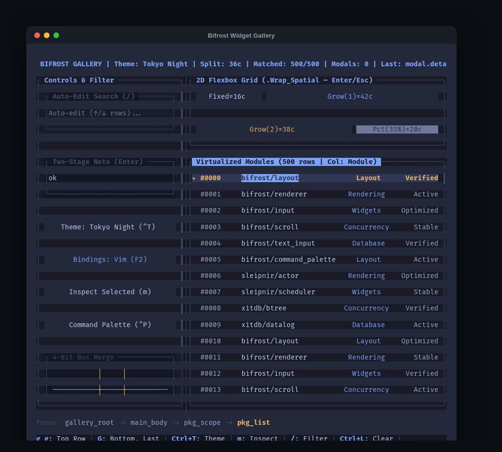
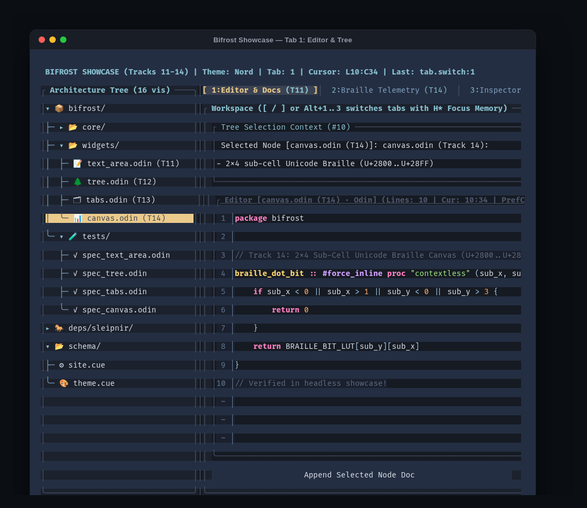
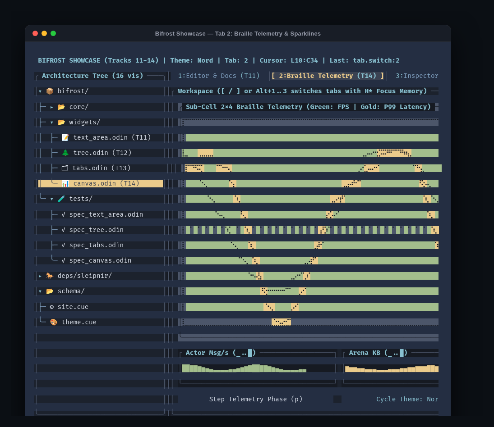
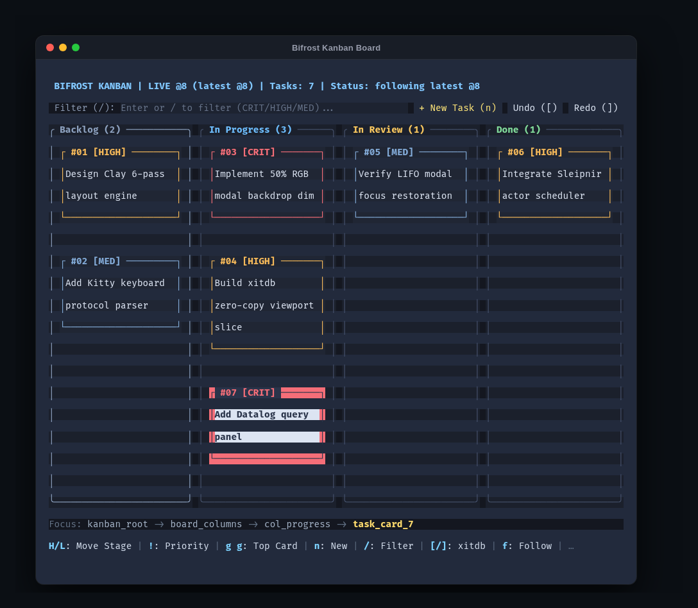
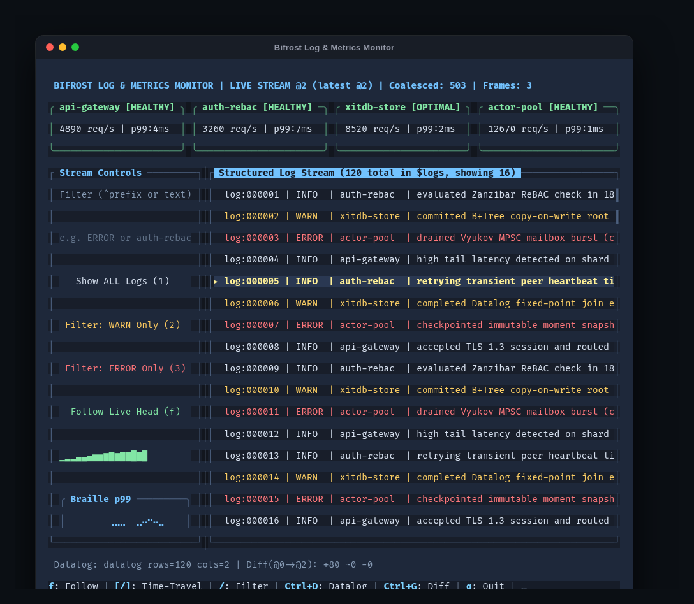
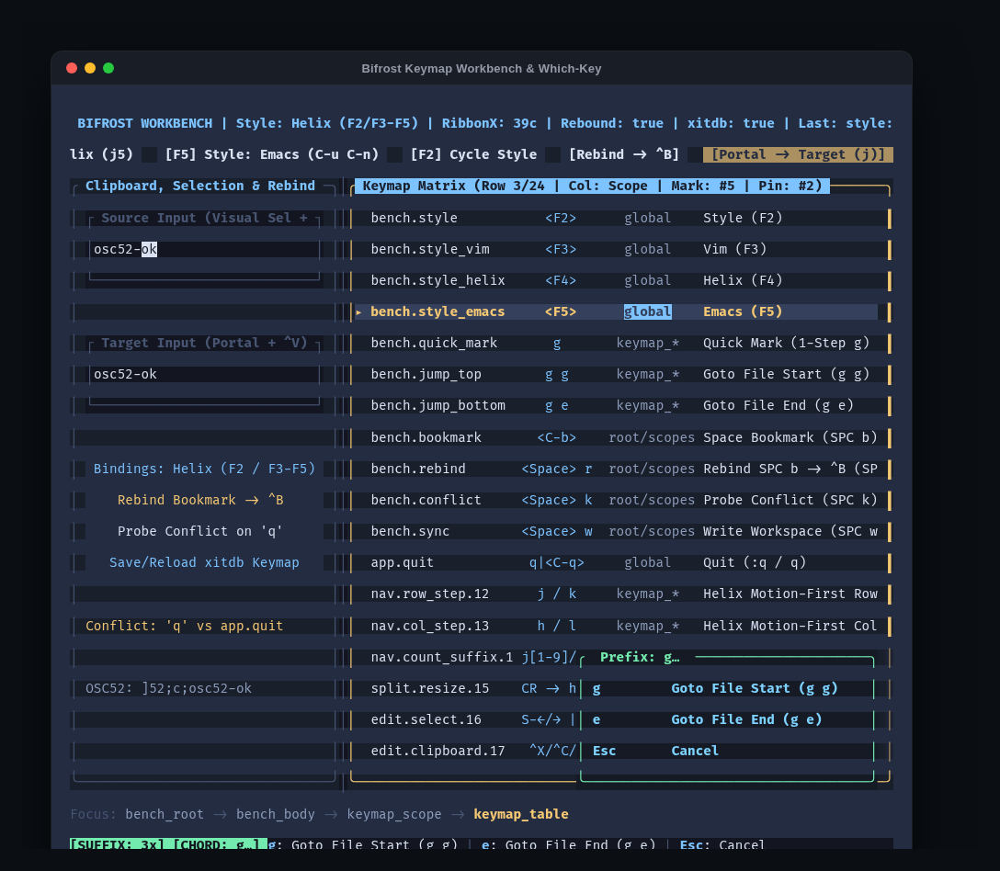

# Bifrost Documentation Hub

Welcome to the documentation for **Bifrost (`package bifrost`)**, an immediate-mode, actor-driven Terminal User Interface (TUI) framework for Odin.

---

## 1. Core Architectural Guides

* **[Navigation, Focus Scopes & Key-Chord DSL Guide](NAVIGATION_AND_DSL_GUIDE.md)**
  * Embedded Harel statechart focus model (`ui_scope`, Shallow $H$ and Deep $H^*$ history, `.Trap_Focus` modal shields)
  * 2D spatial cone navigation (`score_spatial_candidate`, `.Loop_Spatial`, `.Wrap_Spatial`, `.Strict_Spatial`, `nav_overrides`)
  * Two-stage `.Navigation` vs. `.Editing` inputs and `.Scope_Text_Sink` delegation
  * Multi-style modal editing (`Vim`, `Helix`, `Emacs`), struct-tag reflection (`register_actions_struct`), and compile-time AST codegen (`tools/bifrost_gen`)
  * `UI_Coordinator_State` actor sinks, terminal side-effects, and `xitdb` workspace persistence
* **[Core Widget Suite Guide (Tracks 11–14 Overview)](WIDGETS_GUIDE.md)**
  * High-level architectural overview of `ui_text_area`, `ui_tree`, `ui_tabs`, `ui_canvas`, and `ui_sparkline`.

---

## 2. Per-Widget Reference (`docs/widget/`)

Each file in `docs/widget/` documents a specific widget family in detail, including configuration structs, state slots, keyboard and mouse routing, architectural invariants, and complete Odin code examples:

1. **[Layout Primitives, Focus Scopes, Buttons & Modals (`primitives_and_scopes.md`)](widget/primitives_and_scopes.md)**
   * `container`, `leaf`, `ui_scope`, `ui_label`, `ui_button`, and `ui_modal`
   * Sizing primitives (`fit`, `grow`, `fixed`, `percent`), 9-point `Anchor_Point` overlays, and 50% RGB `.Dim_Screen` / `.Dim_Rect` backdrops.
2. **[Single-Line UTF-8 Text Input (`text_input.md`)](widget/text_input.md)**
   * `ui_text_input`, extended grapheme cluster stepping, `.Auto_Edit` vs. `two_stage`, `.Scope_Text_Sink`, `linked_list_id` forwarding, OSC 52 clipboard, and `Xitdb_Filter`.
3. **[Multi-Line UTF-8 Text Editor (`text_area.md`)](widget/text_area.md)**
   * `ui_text_area`, sticky `preferred_col`, dynamic line-number gutter, $O(N + M)$ bulk paste, OSC 52 copy/cut, and built-in **Odin** / **CUE** / custom syntax highlighting.
4. **[Virtualized Lists & 2D Table Solver (`virtual_list_and_table.md`)](widget/virtual_list_and_table.md)**
   * `ui_virtual_list`, 2D `(row, col)` navigation, jitter-free monotonic high-water-mark column solver (`resolve_table_columns`), 64-bit interior-detent scrollbar, and zero-copy `xitdb_slice_viewport`.
5. **[Virtualized Collapsible Tree (`tree.md`)](widget/tree.md)**
   * `ui_tree`, single-pass $O(N)$ pre-order hierarchy builder, $O(\text{visible\_rows})$ node materialization, box-drawing guides (`├─`, `╰─`, `│`, `▾`, `▸`), `h`/`l` parent jump, and `id_hash`-persistent expansion state.
6. **[Focus-Scope-Integrated Tabs (`tabs.md`)](widget/tabs.md)**
   * `ui_tabs` and `ui_tab_bar`, per-tab `<id>_body_<i>` `Focus_Scope` isolation, automatic Deep History ($H^*$) restoration across tab switches, `[` / `]`, and `Alt+1..9`.
7. **[Interactive Pane Splitter (`splitter.md`)](widget/splitter.md)**
   * `ui_splitter`, `get_split_size`, `nudge_splitter`, `bind_splitter_key`, `.Navigate` vs. `.Resize` transient sub-mode, mouse drag, and same-frame sibling rect reflow.
8. **[Fuzzy Command Palette (`command_palette.md`)](widget/command_palette.md)**
   * `ui_command_palette`, `command_palette_init`, `register_command`, `update_command_palette`, multi-token subsequence `fuzzy_score`, and automatic shortcut badge discovery.
9. **[Contextual Status Bars & Which-Key Overlay (`status_bars_and_which_key.md`)](widget/status_bars_and_which_key.md)**
   * `ui_focus_breadcrumb_bar`, `ui_key_hint_bar`, and `ui_which_key_overlay`, zero-lag post-input refresh (`refresh_dynamic_bars`), and mode/count/chord badges.
10. **[Unicode Braille Canvas & Sparklines (`canvas_and_sparkline.md`)](widget/canvas_and_sparkline.md)**
    * `ui_canvas` (`Braille_Canvas` ISO/TR 11548-1 $2 \times 4$ dot matrix `U+2800..U+28FF`, Bresenham lines, rects, `canvas_draw_series`) and `ui_sparkline` (8-level `▁▂▃▄▅▆▇█` vertical block quantization).

---

## 3. Visual Gallery & Example Applications

| Application | Key Components Showcased | Screenshot |
| :--- | :--- | :--- |
| **Widget Gallery** (`examples/widget_gallery`) | Flexbox sizing, splitters, 2D virtual table, Which-Key popup, Tokyo Night theme |  |
| **Showcase — Tab 1** (`examples/widget_showcase`) | Multi-line syntax editor (`ui_text_area`), virtualized collapsible tree (`ui_tree`), tab bar (`ui_tabs`) |  |
| **Showcase — Tab 2** (`examples/widget_showcase`) | 2x4 sub-cell Braille telemetry (`ui_canvas`), 8-level sparklines (`ui_sparkline`) |  |
| **Kanban Board** (`examples/kanban_board`) | 4-column focus scopes with Harel $H/H^*$ memory, word-wrapped cards, xitdb time travel |  |
| **Log Monitor** (`examples/log_monitor`) | High-throughput Sleipnir actor streaming, structured log virtual table, Braille metrics |  |
| **Keymap Workbench** (`examples/keymap_workbench`) | Vim/Helix/Emacs modal styles, Which-Key card, zero-CGO OSC 52 clipboard |  |

---

## 4. Frame Pipeline & Execution Order

Whether you use `UI_Coordinator_State` (`ui_coordinator_flush_frame`) or manage your own loop, a Bifrost frame executes in six deterministic steps:

1. **Begin Frame (`state_store_begin_frame`, `begin_frame`, `begin_layout`):** Clears the back buffer (`Screen.back`) and resets per-frame arenas on `context.temp_allocator`.
2. **Build Widget Tree (`ui_scope`, `ui_tree`, `ui_tabs`, `ui_text_area`, ...):** Pushes `Layout_Node`s in topological pre-order and populates `Screen.paints`.
3. **Solve Layout (`end_layout`):** Runs the 6-pass topological solver:
   * Pass 0: Propagate `effective_z`, `out_of_flow`, and `scope_id`.
   * Pass 1: Bottom-up intrinsic and minimum sizing (reverse topological order).
   * Pass 2: Top-down X-axis sizing (`Percent`, water-draining compression, water-filling `Grow`).
   * Pass 3 & 4: Word/newline text wrapping and bottom-up height re-propagation.
   * Pass 5: Top-down Y-axis sizing, 9-point out-of-flow anchoring, and clipped `Rect` assignment.
   * Pass 6: Stable insertion sort of node indices into `ctx.z_order` by `effective_z` ascending.
4. **Resolve Input (`resolve_input`):** Synchronizes scroll viewports and splitters, reconciles focus scopes ($H^* \rightarrow H \rightarrow \text{Default\_Focus}$) and `.Trap_Focus` modal shields, routes 3-phase `Capturing -> At_Target -> Bubbling` events, and performs reverse-$z$ mouse hit-testing.
5. **Apply Highlights & Refresh Bars (`state_store_sync_from_layout`, `apply_input_highlights`):** Applies 3-state visual highlights (focused, inactive scope-selected $H^*$, hovered, disabled) and refreshes `ui_focus_breadcrumb_bar` and `ui_key_hint_bar` with zero frame lag.
6. **Rasterize & Emit ANSI Diff (`render_layout`, `screen_diff_ansi`, `flush_osc52_clipboard`):** Paints `ctx.z_order` back-to-front (applying 50% RGB `.Dim_Screen` / `.Dim_Rect` backdrops and healing split wide glyphs) and emits minimal SGR diff sequences inside DEC Mode 2026 Synchronized Output.